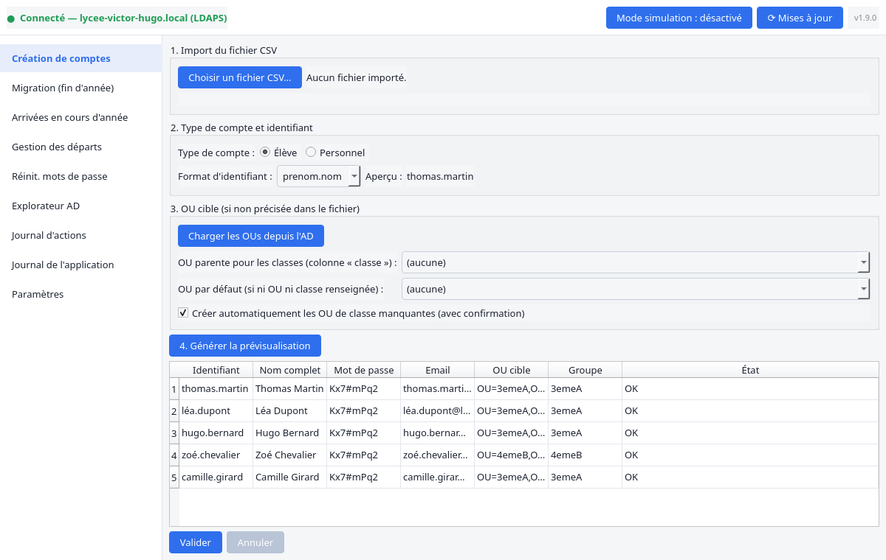
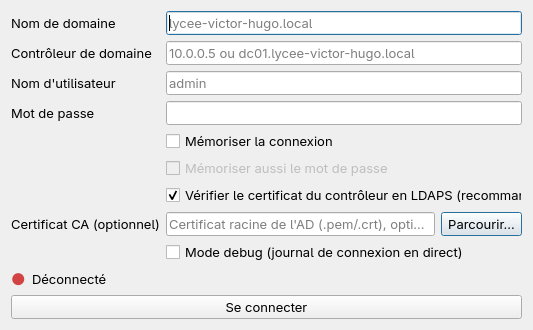
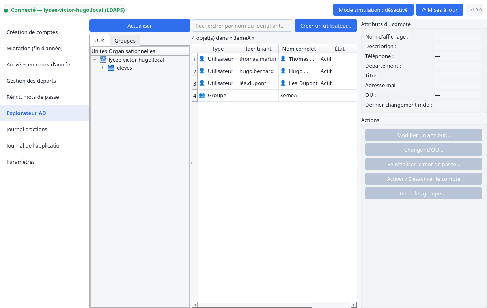

<div align="center">


# EduSync AD

**Gérez le cycle de vie de votre Active Directory sans PowerShell.**

Import CSV, création de comptes, migration, départs, mots de passe : tout se fait depuis une interface unique.

[Guide utilisateur](docs/guide_utilisateur.md) · [Télécharger](https://github.com/estemobs/EduSync-AD/releases/latest) · [Documentation](docs/)

</div>

---

> **Statut** — La version Go (desktop + CLI) est en alpha. La version Python 1.17.1 reste la version stable en production.

## Présentation

EduSync AD est une application desktop qui simplifie l'administration quotidienne d'un Active Directory : arrivées, changements de classe ou de service, départs, réinitialisations de mots de passe. Elle s'adresse aux établissements scolaires, aux PME et aux collectivités, avec une interface pensée pour les opérations en masse.

Chaque écriture dans l'annuaire suit le même chemin : **validation → simulation → exécution → journalisation**. Rien n'est appliqué sans prévisualisation.

## Aperçu

**Création de comptes** — import CSV, prévisualisation et validation avant écriture dans l'AD.



| Connexion | Explorateur AD |
|:---:|:---:|
|  |  |
| Connexion LDAPS et certificat CA | Arborescence des OU, recherche et actions |

## Fonctionnalités

**Gestion des comptes**
- Création depuis un CSV, avec génération des identifiants, mots de passe et adresses mail
- Migration ou restructuration par CSV ou sélection d'OU
- Départs : désactivation immédiate ou archivage avec purge planifiée
- Réinitialisation des mots de passe par OU, groupe ou CSV
- Photos, profils, quotas, scripts de connexion, heures d'accès et dossiers personnels

**Annuaire et exploitation**
- Explorateur AD : arborescence des OU et groupes, recherche en temps réel
- Export CSV et PDF (étiquettes, trombinoscope)
- Journal d'actions filtrable et exportable
- Connexion LDAPS par défaut, avec repli LDAP explicite
- Mise à jour intégrée depuis les releases GitHub

**Sécurité**
- Mode simulation obligatoire avant toute écriture
- Journal append-only, sans suppression possible
- Coffre de mots de passe local chiffré en AES-256
- RBAC à 5 rôles avec portées OU/groupe
- Conformité : RGPD, MFA admin, PSO, signature des exports

**Modules avancés**
- Microsoft 365 / Entra ID, Exchange, RDS
- Multisite, portail d'auto-service, API REST et webhooks
- Modèles de groupes, espaces partagés, sauvegarde/restauration

## Prérequis

- Active Directory accessible (Windows Server 2012 → 2025)
- Un compte disposant des droits de création et de modification des utilisateurs (délégation d'OU recommandée)
- Aucun Python requis sur le poste d'administration

## Installation

**Windows 10/11**

```bash
EduSyncAD-Setup.exe
```

Raccourcis dans le menu Démarrer et sur le Bureau, désinstallation standard via les paramètres Windows.

**Linux**

```bash
# AppImage (recommandé, WebKitGTK embarqué)
chmod +x EduSyncAD-linux.AppImage && ./EduSyncAD-linux.AppImage

# Archive binaire (nécessite libwebkit2gtk-4.1-0)
tar xzf edusync-ad-linux-amd64.tar.gz && ./edusync-ad
```

## Connexion

| Champ | Exemple |
|-------|---------|
| Domaine | `entreprise.local` |
| Contrôleur | `dc01.entreprise.local` ou `10.0.0.5` |
| Utilisateur | `admin` ou `ENTREPRISE\admin` |
| Mot de passe | jamais stocké |

La connexion chiffrée LDAPS (port 636) est tentée en priorité, avec repli sur LDAP + StartTLS si nécessaire. En cas de certificat émis par une autorité interne, consultez la [section dépannage du guide](docs/guide_utilisateur.md#10-dépannage--erreur-de-certificat-ldaps).

## Format CSV

```csv
prenom;nom;equipe
Thomas;Martin;Comptabilité
Léa;Petit;IT
```

Seuls `prenom` et `nom` sont obligatoires. La colonne `equipe` (classe, service, projet, site) sert à résoudre automatiquement l'OU de destination. Des exemples sont disponibles dans [`exemples/`](exemples/).

## Développement

Prérequis : Go 1.27+ et [Task](https://taskfile.dev).

```bash
git clone https://github.com/estemobs/EduSync-AD.git
cd EduSync-AD

task --list                  # liste des commandes
task dev                     # application desktop (Wails v3)
task cli -- paths --json     # CLI
task test                    # tests Go
task lint                    # gofmt + go vet
task build:all               # cross-build vers dist/
```

La CLI `edusync-cli` expose les mêmes opérations que l'interface, avec une sortie JSON stable pour les scripts. Lancez `task cli -- help` pour la liste des commandes.

## Documentation

- [Guide utilisateur](docs/guide_utilisateur.md) — prise en main, modules, dépannage
- [Architecture](docs/ARCHITECTURE.md) — paquets, flux UI, formats de données
- [État d'avancement](docs/STATUS.md) — modules livrés et prochaines étapes
- [Feuille de route Go](ROADMAP_GO_MIGRATION.md) — plan de migration
- [Environnement de test AD](docs/AD_TEST_ENV.md) — Samba AD DC en conteneur

## Contribution

Les contributions sont bienvenues. Voir [CONTRIBUTING.md](CONTRIBUTING.md) et [SECURITY.md](SECURITY.md) pour signaler une vulnérabilité.

## Licence

MIT.
